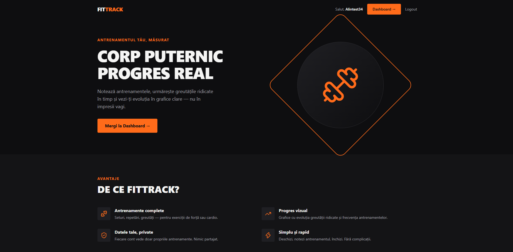
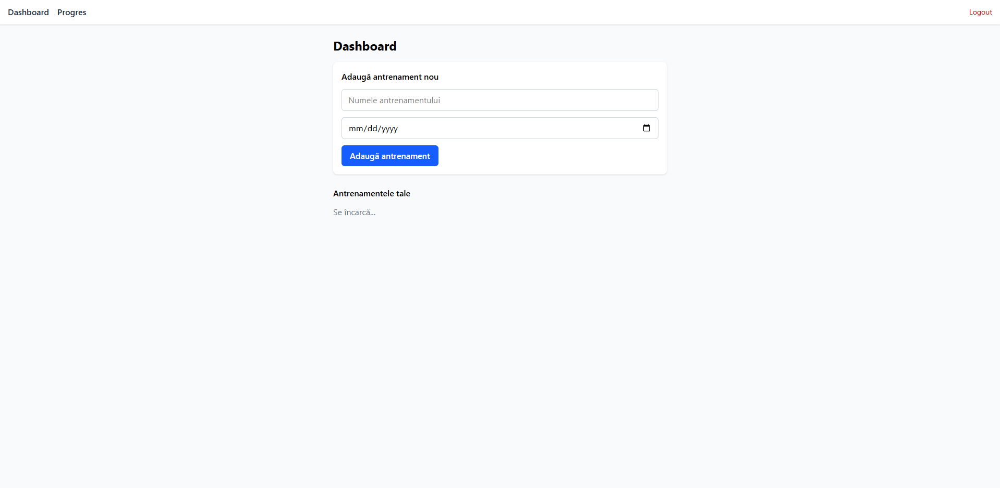
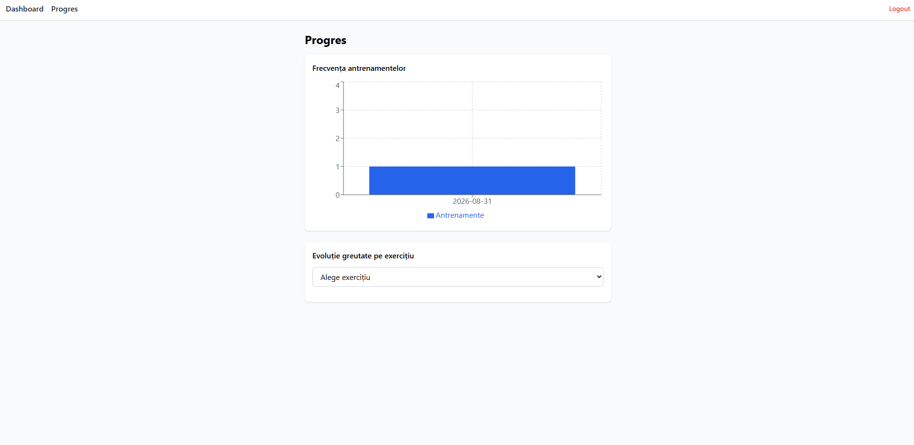

cat > README.md << 'EOF'
# 🏋️ Fitness Tracker App

Aplicație full-stack pentru urmărirea antrenamentelor — notezi exercițiile, seturile, greutățile ridicate, și vezi-ți evoluția reală în timp prin grafice clare.

**🔗 Aplicație live:** [fitness-app-django-react.vercel.app](https://fitness-app-django-react.vercel.app)
**📄 API Docs (Swagger):** [fitness-app-backend-uvi9.onrender.com/api/docs](https://fitness-app-backend-uvi9.onrender.com/api/docs/)


> ⚠️ Backend-ul rulează pe planul gratuit Render, care "adoarme" după perioade de inactivitate — primul request poate dura 30-60 secunde până pornește din nou.

---

## Screenshot-uri





---

## Ce face aplicația

- **Autentificare securizată** cu JWT (access + refresh token, auto-refresh transparent)
- **CRUD complet** pentru antrenamente și seturi (exerciții, repetări, greutăți, sau durată/distanță pentru cardio)
- **35 de exerciții predefinite**, organizate pe grupe musculare
- **Grafice de progres** — frecvența antrenamentelor și evoluția greutății ridicate pe exercițiu
- **Documentație API interactivă** (Swagger/OpenAPI)

## Tech Stack

**Backend**
- Django + Django REST Framework
- JWT Authentication (djangorestframework-simplejwt)
- PostgreSQL (Neon)
- drf-spectacular (Swagger)
- Teste automate + CI (GitHub Actions)
- Black + flake8

**Frontend**
- React + Vite
- React Router, Zustand (state management)
- Tailwind CSS
- Recharts (grafice)
- Axios (cu auto-refresh JWT)
- ESLint + Prettier

**Deploy**
- Backend: Render (Gunicorn + Whitenoise)
- Frontend: Vercel
- Bază de date: Neon (PostgreSQL)

## Provocări tehnice depășite

- Configurare CORS și auto-refresh JWT (interceptor Axios cu coadă de request-uri), pentru o experiență fără întreruperi la expirarea token-ului de acces
- Migrare de la SQLite (dezvoltare) la PostgreSQL permanent (Neon) pentru producție, cu fallback automat pentru testele din CI
- CI/CD complet cu GitHub Actions — testare automată la fiecare push, alinierea versiunilor Python între mediul local, CI și producție
- Deploy separat backend (Render) / frontend (Vercel), conectate corect prin variabile de mediu și CORS

Detalii complete despre deciziile tehnice și obstacolele întâmpinate: [INTERVIEW_NOTES.md](./INTERVIEW_NOTES.md)

## Rulare locală

### Backend
```bash
cd backend
pipenv install
pipenv shell
python manage.py migrate
python manage.py loaddata exercises
python manage.py runserver
```

### Frontend
```bash
cd frontend
npm install
npm run dev
```

Ai nevoie de un fișier `.env` în `backend/` cu `SECRET_KEY`, `DEBUG`, `DATABASE_URL`, și un `.env` în `frontend/` cu `VITE_API_URL`.

## Structură proiect